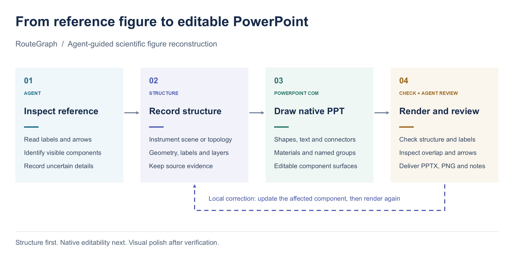

# Reference-to-PowerPoint workflow

An illustrative technical route diagram showing RouteGraph's current workflow. Reference interpretation and scientific judgement remain Agent-led. Instrument figures use the scene compiler; ordinary diagrams use topology tables and native drawing scripts.



[Download editable PowerPoint](workflow.pptx) · [Drawing script](generate.ps1)

| Arrow | From | To | Meaning |
|---|---|---|---|
| reference-to-structure | Inspect reference | Record structure | Record visible content and source evidence |
| structure-to-drawing | Record structure | Draw native PPT | Convert geometry/topology to native objects |
| drawing-to-review | Draw native PPT | Render and review | Inspect the saved output |
| review-to-structure | Render and review | Record structure | Apply a local correction when an error is found |

The dashed return route is one continuous native freeform arrow. Panels are named groups; all figure content is native PowerPoint objects, with no embedded images or SVGs.

Run from the repository root on Windows with PowerPoint installed, using a new output filename:

```powershell
powershell -NoProfile -ExecutionPolicy Bypass -File assets/examples/reconstruction_workflow/generate.ps1 -OutputPath build/workflow-demo.pptx
```

The script also exports a PNG beside the PPTX and closes only its own presentation. The checked-in preview is for GitHub display; the downloadable PPTX remains editable.
